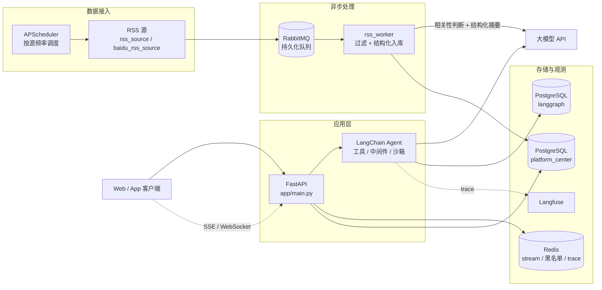
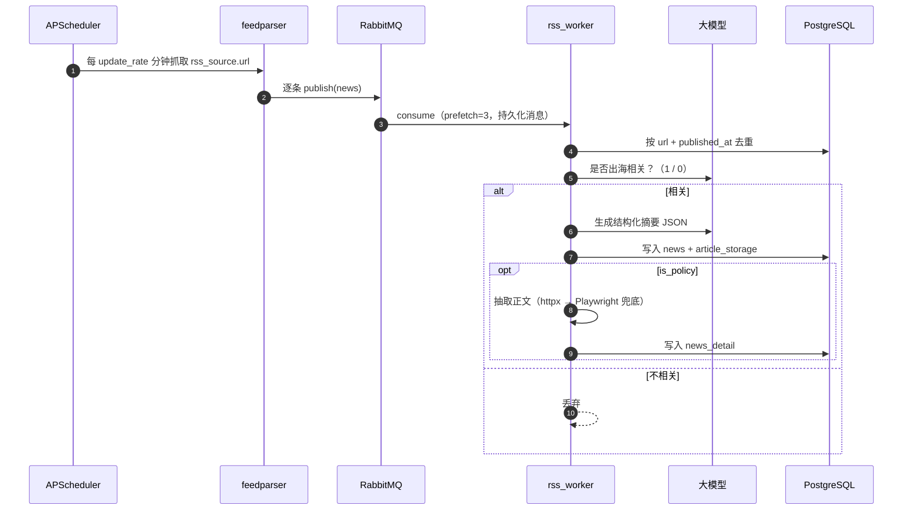

# SEA Platform · 企业出海资讯智能平台（个人练手demo）

> 采集 → AI 过滤 → 结构化加工 → 资讯流 / 详情 / AI 咨询助手
> 把分散在各处的「企业出海」信息，变成可检索、可运营、可二次分发的内容资产。

<p>
  
  
  
  
  
</p>

---

## 目录

- [项目简介](#项目简介)
- [核心能力](#核心能力)
- [系统架构](#系统架构)
- [技术栈](#技术栈)
- [目录结构](#目录结构)
- [快速开始](#快速开始)
- [配置说明](#配置说明)
- [API 概览](#api-概览)
- [数据模型](#数据模型)
- [核心链路](#核心链路)
- [开发约定](#开发约定)
- [已知限制与规划](#已知限制与规划)
- [贡献与许可](#贡献与许可)

---

## 项目简介

**SEA Platform** 是一个面向「企业出海」垂直领域的资讯中台后端，用 AI 降低公众号 / 资讯服务的运营成本，同时提升信息服务能力。

它要解决三个问题：

| 痛点 | 本项目的做法 |
| --- | --- |
| 出海信息分散、获取效率低 | 统一接入 RSS 源（行业媒体、政府部委、海外机构），定时采集并削峰 |
| 内容运营人力成本高 | LLM 自动判断相关性、生成结构化摘要，直接产出可用文案素材 |
| 信息服务能力弱 | 把资讯沉淀为标准 API，并提供基于「引用文章」的实时 AI 咨询助手 |

**服务对象**：公众号运营团队、出海咨询 / 服务机构、有计划出海或已在出海的企业与个人从业者。

---

## 核心能力

| 能力 | 说明 | 关键实现 |
| --- | --- | --- |
| 多源资讯采集 | 按每个源配置的 `update_rate` 定时抓取 RSS，消息投递到队列异步处理 | `APScheduler` + `feedparser` + `RabbitMQ` |
| AI 相关性过滤 | 判断内容是否属于出海 / 政策相关领域，只保留相关项 | `system_prompt_polic_judge`（输出 `1` / `0`） |
| AI 结构化加工 | 一次调用产出：一句话速读、详细摘要、Topic 聚类、关键词、行业分类、政策/市场风险 | `JsonOutputParser` + `NewsAnalysis` Schema |
| 行业分类映射 | LLM 输出的行业名与 `category` 表做模糊匹配，未命中兜底「其他」 | `CategoryOperator` |
| 正文抽取 | 先 `httpx` 抓取，失败或触发反爬时自动切 `Playwright` | `fetch_full_text` |
| 资讯流 / 详情 API | 分页、按分类筛选、回填 RSS 来源标签与 AI 摘要 | `/news`、`/news_detail` |
| AI 咨询助手 | Agent 具备联网搜索、网页抓取、图片搜索、引用文章读取等工具，流式输出并持久化会话 | `create_agent` + `LangGraph` checkpointer |
| 用户体系 | JWT 登录、Redis Token 黑名单、argon2 密码哈希、邮箱验证码 | `python-jose` + `passlib[argon2]` |
| 推送配置 | 维护推送渠道、分类权重与最大推送量（仅配置读写，投递能力待实现） | `user_push_config` 系列表 |
| 可观测性 | 请求级 `request_id` + 耗时、分级日志、LLM 链路追踪 | `loguru` + `Langfuse` |

---

## 系统架构



---

## 技术栈

| 分类 | 选型 |
| --- | --- |
| Web 框架 | FastAPI、Uvicorn、SSE-Starlette、WebSocket |
| Agent / LLM | LangChain 1.x、LangGraph、DeepAgents、LangChain OpenAI / DeepSeek 适配 |
| 数据层 | PostgreSQL 16、SQLAlchemy 2.0（async）、asyncpg、JSONB |
| 异步与调度 | RabbitMQ（aio-pika）、Redis、APScheduler |
| 采集与解析 | feedparser、httpx、BeautifulSoup4、readability-lxml、crawl4ai、Playwright |
| 认证安全 | python-jose（JWT）、passlib + argon2、email-validator |
| 可观测性 | loguru、Langfuse |
| 工程化 | uv（依赖与虚拟环境）、Docker / Docker Compose、black |

---

## 目录结构

```text
sea_platform/
├── app/
│   ├── main.py                # FastAPI 入口：路由注册、生命周期、健康检查、静态目录
│   ├── api/                   # 路由层：参数校验 + 调用 service，不写业务逻辑
│   ├── services/              # 业务编排层（AI 对话、新闻、用户、推送配置、文件…）
│   ├── crud/                  # 数据访问层（data_crud/* 按表拆分）
│   ├── models/                # SQLAlchemy ORM 模型
│   ├── schemas/               # Pydantic 出入参（按业务域分目录）
│   ├── config/                # 配置与连接：settings、PG、Redis、RabbitMQ、Qdrant、LLM
│   ├── core/                  # 调度器、当前用户依赖
│   ├── crawler/               # RSS 抓取与解析
│   ├── tasks/                 # 异步任务（原 Celery 链路，已弃用待移除）
│   ├── factory/               # Agent 装配工厂
│   │   ├── agent/             #   AgentFactory：模型 / 工具 / 中间件 / 子代理 / 后端
│   │   ├── tools/             #   web_search、web_fetch、image_search、引用文章工具
│   │   ├── middlewares/       #   悬空工具调用修复、动态环境注入、上下文清理等
│   │   ├── backend/           #   Linux / Windows 沙箱文件系统后端
│   │   ├── subagents/         #   子代理（预留）
│   │   └── callback/          #   Langfuse 回调
│   ├── rag/                   # 提示词、检索器、对话流水线、状态节点
│   ├── middlewares/           # 请求日志中间件（纯 ASGI，兼容 SSE）
│   └── utils/                 # 日志、JWT、结果封装、正文抽取、HTML 清洗等
├── worker/
│   └── rss_result_execute_worker.py   # 队列消费者：去重 → AI → 入库
├── sql/                       # 建表与种子数据，容器首次启动自动按文件名顺序导入
│   └── script/                # 一次性脚本（RSS 源抓取等）
├── docker/Dockerfile          # 两阶段构建（uv 构建 + 精简运行镜像）
├── docker-compose.yml         # 生产编排
├── docker-dev-compose.yml     # 开发编排（代码挂载 + 热更新）
├── static/                    # 本地 Swagger UI 资源
├── attach/                    # 用户上传文件与安装包（git 忽略内容）
├── logs/                      # 分级日志输出
├── main.py                    # 本地启动入口（Windows 事件循环适配）
└── pyproject.toml / uv.lock   # 依赖声明与锁定
```

---

## 快速开始

### 前置要求

- **Docker 方式**：Docker Engine + Docker Compose v2
- **本地方式**：Python **3.12**（`>=3.12,<3.13`）+ [uv](https://docs.astral.sh/uv/)
- 一个可用的 OpenAI 兼容大模型接口（DeepSeek 或自建网关）
- 首次启动需要拉取依赖与 Playwright Chromium，网络较慢时请耐心等待

### 1. 准备环境变量

```bash
# macOS / Linux
cp .env.example .env
```

```powershell
# Windows PowerShell
Copy-Item .env.example .env
```

`.env` 已被 `.gitignore` 忽略，请勿提交。至少需要补齐：

| 变量 | 说明 |
| --- | --- |
| `RABBITMQ_DEFAULT_USER` / `RABBITMQ_DEFAULT_PASSWORD` | 必填，无默认值 |
| `JWT_SECRET_KEY` / `JWT_ALGORITHM` | 必填，无默认值（建议 `HS256`） |
| `BASE_MODEL` / `API_KEY` / `BASE_URL` | 大模型接入（也可用 `LLM_*_DEEPSEEK` 系列） |
| `TAVILY_API_KEY` | 使用 `WEB_SEARCH_PROVIDER=tavily` 时需要 |
| `PG_*` / `REDIS_*` | 数据库与缓存连接 |

### 2. 启动方式

#### 方式 A：Docker Compose（开发，推荐）

```bash
docker compose -f docker-dev-compose.yml up -d --build
```

特点：源码目录挂载进容器（改代码后 `docker compose -f docker-dev-compose.yml restart api` 即可生效），PostgreSQL 数据落在命名卷 `pg_data_dev`。

| 服务 | 容器名 | 宿主机端口 |
| --- | --- | --- |
| API | `sea_api_dev` | `8000` |
| PostgreSQL | `sea_postgres_dev` | `15433` |
| Redis | `sea_redis_dev` | `6380` |
| RabbitMQ | `sea_rabbitmq_dev` | `5673` / 控制台 `15673` |
| Qdrant | `sea_qdrant_dev` | `6333` / `6334` |
| RSS Worker | — | 无 |

> ⚠️ 开发编排里 `celery_worker` 处于**注释状态**，后续会彻底移除。对话请走 `/chatMessage/ws/chat_with_ai` 直连 Agent（见方式 C）。

#### 方式 B：Docker Compose（生产）

```bash
docker compose up -d --build
```

与开发编排的差异：代码不挂载、API 以 `--workers 2` 运行、各服务配置了 CPU / 内存上限与日志轮转、数据卷使用**宿主机绝对路径**。

| 服务 | 容器名 | 宿主机端口 |
| --- | --- | --- |
| API | `sea_api_prod` | `8000` |
| PostgreSQL | `sea_postgres_prod` | `15433` |
| Redis | `sea_redis_prod` | `6379` |
| RabbitMQ | `sea_rabbitmq_prod` | `5672` / 控制台 `15672` |
| Qdrant | `sea_qdrant_prod` | `6333` |
| RSS Worker | — | 无 |

> ⚠️ 生产编排把数据目录固定为 `/home/ubuntu/data/{postgres,redis,rabbitMQ,qdrant}`。请在目标主机上先创建并授权这些目录；换机器 / 换用户部署时必须先改 `docker-compose.yml`。

#### 方式 C：本地裸跑（调试首选）

```bash
# 1) 安装依赖（自动创建 .venv）
uv sync

# 2) 安装 Playwright 浏览器（正文抽取兜底需要，Docker 镜像内已预装）
uv run playwright install chromium

# 3) 只起基础设施, 或在.env中自行配置对应的服务主机、端口
docker compose -f docker-dev-compose.yml up -d postgres redis rabbitmq qdrant

# 4) 启动 API
uv run python main.py
# 等价于：uv run uvicorn app.main:app --host 0.0.0.0 --port 8000
# DEBUG=true 时自动开启 reload

# 5) 另开终端启动队列消费者（资讯入库链路必需）
uv run python worker/rss_result_execute_worker.py
```

> 本地裸跑时，`.env` 里的端口要填**宿主机映射端口**：`PG_PORT=15433`、`REDIS_PORT=6380`、`RABBITMQ_PORT=5673`；而容器内运行时对应为 `5432` / `6379` / `5672`。

> Windows 提示：`main.py` 已为 Windows 切换到 `WindowsSelectorEventLoopPolicy`；直接跑 `uvicorn` 时若遇到事件循环相关报错，请改用 `python main.py`。

### 3. 数据库初始化

- PostgreSQL 容器**首次**启动时会自动执行 `sql/` 下的 `*.sql`（按文件名排序）。`00_init_schema.sql` 会创建 `platform_center` 与 `langgraph` 两个 schema 及所需序列。
- 应用启动时通过 `AsyncPostgresSaver.setup()` 自动创建 LangGraph 的 checkpoint 表。
- 已有数据卷时初始化脚本**不会**重跑。需要重建请执行 `docker compose down -v`（会清空数据），或手动导入 SQL。

### 4. 默认账号

种子数据内置管理员：**`admin` / `admin123`**（密码为 argon2 哈希）。**上线前请立即修改密码。**

### 5. 验证

```bash
curl http://localhost:8000/health
# {"status":"healthy","langgraph_postgres":"LangGraph PostgreSQL 连接成功"}
```

| 地址 | 用途 |
| --- | --- |
| `http://localhost:8000/health` | 健康检查（含 LangGraph 连通性） |
| `http://localhost:8000/docs-zh` | Swagger UI（使用本地 `static/` 资源，内网可用） |
| `http://localhost:8000/docs-cn` | Swagger UI（CDN 资源） |
| `http://localhost:8000/openapi.json` | OpenAPI 描述 |

---

## 配置说明

所有配置通过 `pydantic-settings` 从 `.env` 读取（未声明在 `Settings` 中的变量会被忽略）。以下为分组摘要，完整清单见 `.env.example`。

### 服务与运行

| 变量 | 默认 | 说明 |
| --- | --- | --- |
| `APP_NAME` | `sea_ai_platform` | 应用名，同时写入 PG `application_name` |
| `SERVER_ENV` | `test` | 环境标识 |
| `DEBUG` | `true` | 开启 SQL echo 与 uvicorn reload |
| `SERVER_HOST` / `SERVER_PORT` | `localhost` / `8000` | 生成文件访问 URL 与二维码时使用，**生产必须是可外网访问的域名** |
| `RSS_SCHEDULER_ENABLED` | `false` | 是否启用 APScheduler 定时采集 |

### 基础设施

| 变量 | 说明 |
| --- | --- |
| `PG_HOST` / `PG_PORT` / `PG_USER` / `PG_PASSWORD` / `PG_DB` | PostgreSQL 连接 |
| `PG_SCHEMA` | 业务表 schema（`search_path`），默认应为 `platform_center` |
| `REDIS_HOST` / `REDIS_PORT` / `REDIS_PASSWORD` | 流式缓存、Token 黑名单、`trace_id` 映射 |
| `RABBITMQ_HOST` / `RABBITMQ_PORT` / `RABBITMQ_NAME` | 队列地址与队列名（生产者与消费者必须一致） |
| `RABBITMQ_DEFAULT_USER` / `RABBITMQ_DEFAULT_PASSWORD` | 必填 |
| `QDRANT_HOST` / `QDRANT_PORT` / `QDRANT_API_KEY` | 预留，当前仅接入配置，未参与检索 |

### 大模型与 Agent

| 变量 | 说明 |
| --- | --- |
| `BASE_MODEL` / `API_KEY` / `BASE_URL` | 通用 OpenAI 兼容模型配置（优先使用） |
| `LLM_BASE_MODEL_DEEPSEEK` / `LLM_API_KEY_DEEPSEEK` / `LLM_BASE_URL_DEEPSEEK` | DeepSeek 专用配置（兜底） |
| `PROVIDER` | 提供商标识，如 `custom` |
| `THINKING_ENABLED` / `SUPPORTED_THINKING` / `REASONING_EFFORT` | 思考模式开关与推理强度（`low` / `medium` / `high`） |
| `TEMPERATURE` / `ENABLED_PENALTY` / `FREQUENCY_PENALTY` / `PRESENCE_PENALTY` | 采样与惩罚因子 |
| `BACKEND_NAME` | Agent 沙箱后端：`linux_filesystem_shell` / `windows_filesystem_shell` / 留空不启用 |
| `BACKEND_DIR` | 沙箱工作根目录 |
| `CONTEXT_EDITING_*` | 上下文清理中间件（触发阈值、保留条数、排除工具等） |
| `FILESYSTEM_FILE_SEARCH_*` | 文件搜索中间件（根目录、是否用 ripgrep、单文件上限） |
| `PII_*` | 敏感信息检测与脱敏规则 |
| `WEB_SEARCH_PROVIDER` / `TAVILY_API_KEY` | 联网搜索后端（`tavily` / `duckduckgo`） |
| `ENABLED_IMAGES_SEARCH` | 是否向 Agent 暴露图片搜索工具 |

### 认证、邮件与日志

| 变量 | 说明 |
| --- | --- |
| `JWT_SECRET_KEY` / `JWT_ALGORITHM` | 必填，JWT 签发与校验 |
| `ACCESS_TOKEN_EXPIRE_MINUTES` | Token 有效期（单位：天，默认 7） |
| `SMTP_HOST` / `SMTP_PORT` / `SMTP_USER` / `SMTP_PASSWORD` / `SMTP_FROM` | 验证码邮件（`SMTP_PASSWORD` 填邮箱授权码） |
| `LANGFUSE_ENABLED` / `LANGFUSE_SECRET_KEY` / `LANGFUSE_PUBLIC_KEY` / `LANGFUSE_BASE_URL` | LLM 链路追踪 |
| `LOG_DIR` | 日志目录（相对路径以项目根目录为基准，容器内即 `/app/logs`） |
| `LOG_CONSOLE_LEVEL` | 控制台日志级别，设为 `CRITICAL` 可关闭控制台输出 |
| `LOG_DIAGNOSE` | 是否在堆栈中展开局部变量；**生产建议关闭**（会打印 token、密码等） |

### Docker 网络注意

Compose 只覆盖了部分连接变量（如 `PG_HOST`、`PG_PORT` 会被改成容器内地址），但 **Redis / RabbitMQ 的 host、port、队列名仍取自 `.env`**。因此：

- 容器内运行时，`REDIS_HOST` / `RABBITMQ_HOST` 应指向服务名（`redis` / `rabbitmq`），端口应为容器内端口（`6379` / `5672`）；
- 本地裸跑时则应指向宿主机地址与映射端口；
- 若一份 `.env` 要同时满足两种场景，建议容器侧使用宿主机可达地址（如 `host.docker.internal`），或为容器单独准备环境文件。

---

## API 概览

统一响应结构（`app/utils/result_response.py`）：

```json
{ "code": "200", "msg": "成功", "data": {} }
```

`code` 为字符串，`200` 表示成功；业务错误码见 `ResultCode`（如 `401` 未登录、`5003` 账号或密码错误、`6000` 数据不存在）。

「鉴权」列中的 ✅ 表示需要请求头 `Authorization: Bearer <token>`。

### 用户

| 方法 | 路径 | 鉴权 | 说明 |
| --- | --- | --- | --- |
| POST | `/user/login` | — | 登录，返回 token 与用户信息，并记录登录 IP |
| POST | `/user/register` | — | 注册（argon2 哈希存储密码） |
| POST | `/user/verify` | — | 注册前校验用户名 / 手机号是否已存在 |
| PUT | `/user/update_info` | ✅ | 更新个人资料 |
| PUT | `/user/update_password` | ✅ | 修改密码，旧 Token 进入黑名单 |
| POST | `/user/logout` | 需带 Token | 注销，Token 加入黑名单 |

### 资讯

| 方法 | 路径 | 鉴权 | 说明 |
| --- | --- | --- | --- |
| GET | `/news/get_news` | — | 新闻分页列表（含 RSS 来源标签） |
| GET | `/news_detail/get_news_detail` | — | 资讯详情分页，支持 `category_id` 筛选，按发布时间倒序 |
| GET | `/news_detail/get_detail_by_id` | — | 单篇资讯详情 |
| GET | `/category/get_category` | — | 有效分类列表 |
| GET | `/category/get_category_by_id` | — | 按 ID 查分类 |
| GET | `/rss/active_rss` | — | 已激活的 RSS 源 |
| GET | `/rss/get_by_id` | — | 按 ID 查 RSS 源 |

### 会话与对话

| 方法 | 路径 | 鉴权 | 说明 |
| --- | --- | --- | --- |
| GET | `/session/get_sessions` | — | 按 `user_id` 查会话列表 |
| PUT | `/session/new_session` | ✅ | 新建会话（空会话复用） |
| PUT | `/session/new_session_thread` | ✅ | 新建会话并生成 `thread_id`（LangGraph 用） |
| GET | `/chatMessage/get_by_session_id` | — | 会话历史消息 |
| PUT | `/chatMessage/insert_message` | — | ⚠️ 已弃用：写入用户消息并提交 Celery 任务，返回 `task_id` |
| GET | `/chatMessage/chat_stream/{task_id}` | — | ⚠️ 已弃用：**SSE** 读取 Celery 链路的增量内容 |
| WS | `/chatMessage/ws/chat/{task_id}` | — | ⚠️ 已弃用：WebSocket 轮询 Redis 增量 |
| WS | `/chatMessage/ws/chat_with_ai` | — | WebSocket 直连 Agent，流式对话（推荐） |
| POST | `/llm/llm_stream_test` | ✅ | 直连 Agent 的 SSE 调试接口 |

**流式协议说明**

- WebSocket Agent 消息体含 `status` 字段：`analyzing`（思考中）、`retrieving`（调用工具）、`generating`（生成中）、`done`、`exception`；`trace_id` 用于串联 Langfuse 追踪。
- 上述 `[[END]]` / `[[ERROR]]` 结束标记仅属于已弃用的 Celery 流式链路；新接入请使用 `ws/chat_with_ai`。
- `/llm/llm_stream_chat` 为占位接口，暂未实现。

### 文件、配置与邮件

| 方法 | 路径 | 鉴权 | 说明 |
| --- | --- | --- | --- |
| POST | `/file/upload_file` | ✅ | 上传文件，按类型落到 `attach/` 子目录，返回访问 URL |
| GET | `/file/download/app/latest` | — | App 最新安装包地址与二维码（Android / iOS） |
| POST | `/userConfig/get_config` | ✅ | 查询推送配置 |
| PUT | `/userConfig/insert_config` | ✅ | 创建推送配置 |
| PUT | `/userConfig/update_config` | ✅ | 更新推送配置 |
| POST | `/email/send_code` | ✅ | 发送邮箱验证码 |
| POST | `/email/verify_code` | ✅ | 校验邮箱验证码 |
| POST | `/email/register/send_code` | — | 注册场景发送验证码 |
| POST | `/email/register/verify_code` | — | 注册场景校验验证码 |
| GET | `/health` | — | 健康检查 |

> 上传目录通过 `/attach` 静态挂载对外暴露。生产环境建议前置网关鉴权或改用对象存储 + 签名 URL。

---

## 数据模型

业务表位于 `platform_center` schema，LangGraph 状态表位于 `langgraph` schema。

| 表 | 说明 |
| --- | --- |
| `user` / `user_profiles` | 用户账号与画像 |
| `user_push_config` | 推送总开关、最大推送量（按用户唯一） |
| `user_push_notify_channel` | 推送渠道 |
| `user_push_category_weight` | 分类权重 |
| `chat_session` | 会话（含 `thread_id`、会话主题） |
| `chat_message` | 消息（角色、类型、引用资料、思考内容、评分与反馈） |
| `news` | 新闻主表（标题、URL、来源、发布时间、是否政策相关） |
| `news_detail` | 详情表（正文、全文、AI 结构化输出 `ai_origin_output`、分类） |
| `article_storage` | 原始输入归档（原始 entry / URL） |
| `rss_source` / `baidu_rss_source` | RSS 源配置（频率、是否激活、热度、评分） |
| `category` | 行业分类（含示例描述，供 LLM 匹配） |
| `system_message` | 系统消息 |
| `llm_api_log` | LLM 调用日志 |
| `langgraph.checkpoint*` | Agent 会话检查点（启动时自动创建） |

---

## 核心链路

### 一、资讯采集与入库



### 二、AI 对话

对话统一走 **直连 Agent**：`WS /chatMessage/ws/chat_with_ai`（推荐）或 `POST /llm/llm_stream_test`。进程内流式输出，支持工具调用与思考过程，LangGraph checkpointer 持久化上下文，消息在 service 层统一落库。

> 原 `/chatMessage/insert_message` → Celery → Redis → SSE 轮询的异步链路已**弃用**：一是任务函数为 `async def`，Celery 不会 await 协程；二是多一跳队列对时延与资源开销影响明显。相关代码与 `celery_worker` 服务将在后续迭代中移除。

Agent 装配在 `AgentFactory` 中完成，采用工厂模式按需拼装：

- **模型**：OpenAI 兼容客户端；DeepSeek 走子类补丁，保留 `reasoning_content` 以支持 thinking 模式下的工具调用续跑。
- **工具**：`web_search`（Tavily / DuckDuckGo）、`web_fetch`（crawl4ai + readability，含内网地址拦截）、`image_search`、`report_security`、`search_saved_news` / `check_news_length_or_summary`（读取用户引用的文章）。
- **中间件**：悬空工具调用修复、运行时日期注入、上下文清理、文件搜索、PII 脱敏。
- **后端**：Linux / Windows 文件系统沙箱。

---

## 开发约定

**分层职责**

```text
api/       路由与参数校验，只调用 service，不写业务逻辑
services/  业务编排（组合 crud、LLM、外部服务）
crud/      单表 SQL 操作
models/    ORM 映射
schemas/   出入参定义（Pydantic）
```

**新增一个接口的推荐顺序**：`schemas` → `models` / `crud` → `services` → `api` → 在 `app/main.py` 中 `include_router`。

**日志**

```python
from app.utils.log import logger

logger.info("上传完成 | user={} | filename={!r}", user, filename)
logger.opt(exception=True).error("保存文件失败 | filename={!r}", filename)  # 保留堆栈
```

日志写入 `logs/access`、`logs/error`，文件名带进程启动当天的日期；超长日志单独落到 `logs/*_long_access.log`；单文件超过 500 MB 自动轮转压缩。

**其他约定**

- 统一响应使用 `Result.success()` / `Result.error()`，不要直接返回裸字典。
- 时间统一按 `Asia/Shanghai` 处理（Compose 已设置 `TZ`）。
- 代码格式化：`uv run black app worker`。
- 中间件、工具、后端、子代理均通过 `app/factory/` 下的工厂扩展，避免改动 Agent 主流程。
- 异步任务与流式接口的异常必须落到日志并更新消息状态，避免前端永久等待。

---

## 已知限制与规划

- **向量检索未接入**：`app/rag/{chunk,embeddings,rerank}` 与 Qdrant 目前只有配置骨架，语义检索尚未实现，当前「RAG」实质是按 `news_id` 精确取回文章。
- **Celery 正在下线**：`app/tasks/` 与 compose 中的 `celery_worker` 已弃用，仅保留代码与依赖待后续迭代清理；请勿在新功能中依赖该链路。
- **无自动化测试**：仓库暂未包含单元测试与 CI 流水线。
- **部分查询接口未鉴权**：会话列表、历史消息等接口仅按 `user_id` / `session_id` 查询，生产环境需补充越权校验。
- **生产编排绑定固定主机路径**：`docker-compose.yml` 的数据卷为 `/home/ubuntu/data/*`，换环境需修改。
- **健康检查依赖 curl**：Compose 的 healthcheck 调用 `curl`，而运行镜像未安装该命令，容器可能长期显示 `unhealthy`（不影响服务本身）。
- **队列可靠性**：消费端为 `requeue=True` + `reject_on_redelivered=True`，尚无死信队列与退避重试策略。
- **静态资源直出**：`/attach` 无鉴权，生产建议改用对象存储或加网关保护。

---

## 贡献与许可

- 提交前请确保本地可启动、接口自测通过，并保持日志与错误处理风格一致。
- Commit 信息沿用仓库现有风格：`feat(scope): ...`、`fix(scope): ...`、`refactor: ...`。
- 仓库当前**未包含 LICENSE 文件**；如需开源分发，请先补充许可证声明。
